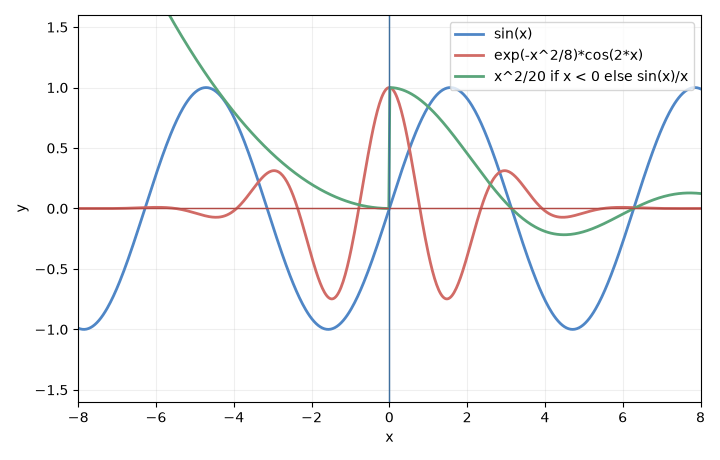
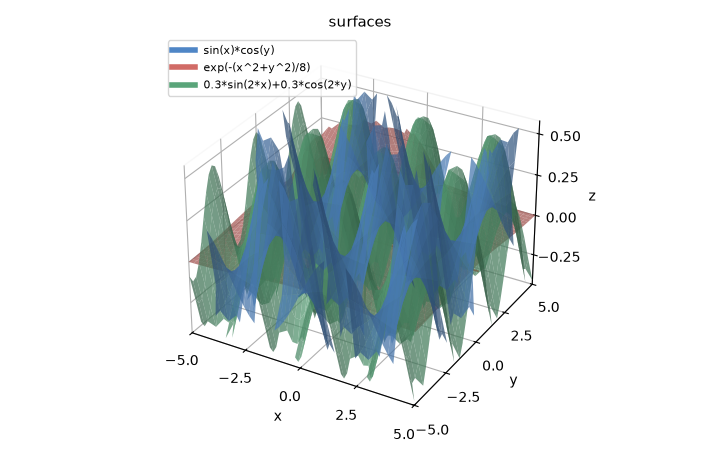
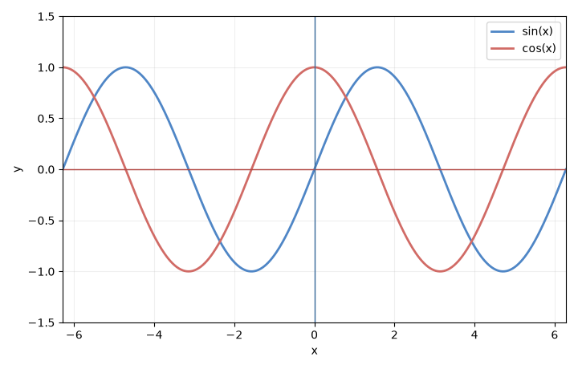
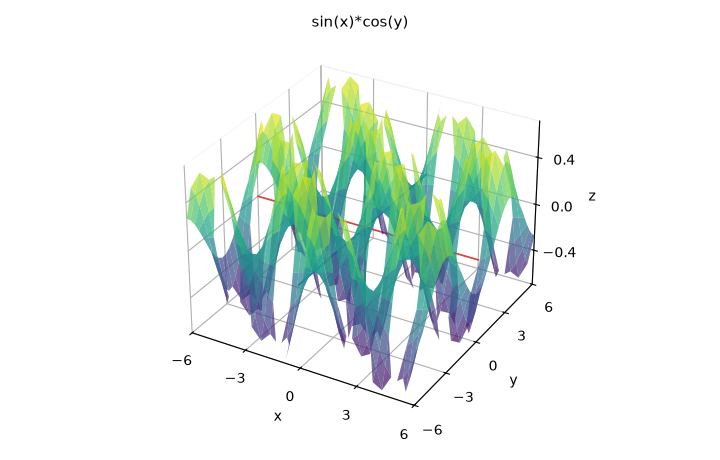
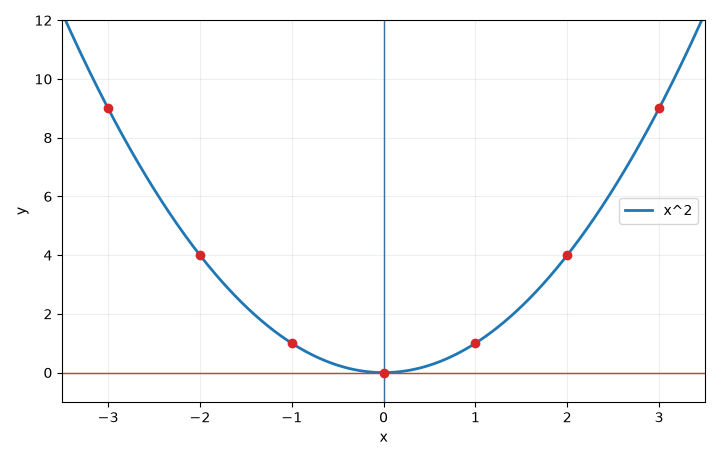
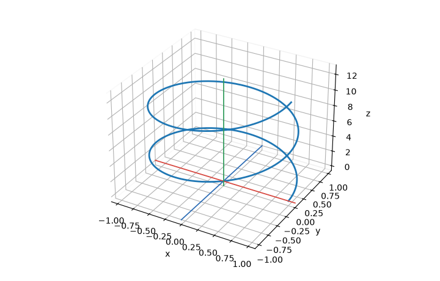
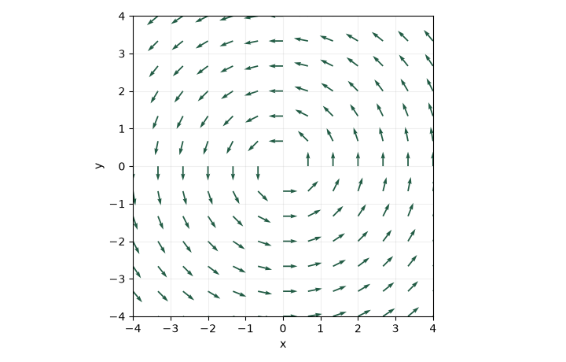
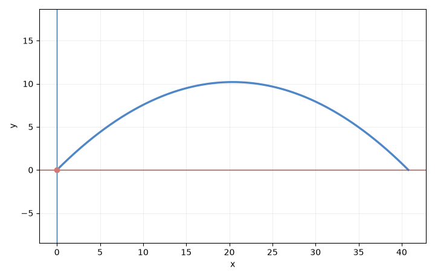

# Locus

[中文](README.zh.md) · [Client setup](docs/CLIENTS.md) · [Examples](docs/EXAMPLES.md)

A locus is the set of points a formula picks out. In the chat, tell the model to draw something harder than a single sine wave: several curves on one pair of axes, or several surfaces in one x, y, z view. Locus draws that picture and hands it back in the reply.
Install with `uv run locus`. The repository is [Locus](https://github.com/TheGrSun/Locus).
Python 3.10+ · FastMCP 2.x · Apache-2.0.

## What works

| Tool | Result | Requirements |
| --- | --- | --- |
| `validate_formula` | Normalized formula or actionable syntax guidance | Offline |
| `plot_math_function` | PNG image and optional saved file | Offline |
| `plot_multiple_functions` | 1–12 curves on shared axes | Offline |
| `explore_functions` | Those curves plus each formula's analysis, in one result | Offline |
| `plot_3d_surface` | 1–6 sampled surfaces `z = f(x, y)` on one view | Offline |
| `plot_points` | Scatter data in 2D or 3D, with an optional formula | Offline |
| `plot_parametric` | Curve `x(t), y(t)` or `x(t), y(t), z(t)` | Offline |
| `plot_vector_field` | Arrows for a 2D field `(fx, fy)` | Offline |
| `simulate_physics` | Projectile, oscillator, or x(t), y(t), with the measured trajectory | Offline |
| `analyze_formula` | Domain; optionally range, derivative, stationary points and corner candidates | Offline |

Offline curve tools accept `y = x^2`, `2*x + 1`, `sin(x)`, `sqrt(x)`, `abs(x)`, `pi` and `e`.
`plot_3d_surface` accepts one surface, or `formulas` with up to six, on one view. The chat image does not rotate. Orbit and zoom are in the local page below.
`explore_functions` plots several `y=f(x)` curves and returns each analysis with that picture.

## What the plots look like

These pictures are the offline PNG results. The local page opens with the same two overlays already filled in.

| Several 2D curves | Several 3D surfaces |
| --- | --- |
|  |  |
| `sin(x)`, `exp(-x^2/8)*cos(2*x)`, and `x^2/20 if x < 0 else sin(x)/x` | `sin(x)*cos(y)`, `exp(-(x^2+y^2)/8)`, and `0.3*sin(2*x)+0.3*cos(2*y)` |

| Curves | Surface |
| --- | --- |
|  |  |
| `sin(x)` and `cos(x)` | `z = sin(x)*cos(y)`, one x, y, z view |

| Points | Parametric curve |
| --- | --- |
|  |  |
| Points on `y = x^2` | `x = cos(t)`, `y = sin(t)`, `z = t` |

| Vector field | Projectile |
| --- | --- |
|  |  |
| `fx = -y`, `fy = x` | Launch at 20 and 45 degrees |

## What the assistant returns

An offline plotting call returns **native MCP PNG image content** plus text metadata containing the formula,
warnings, and a saved file path when saving is enabled. Image-capable clients can show the plot directly in chat.

Offline 3D is a sampled surface image. Symbolic analysis stays two-dimensional.

## Verification status

The 0.2 release passed 42 Python tests and 3 isolated JavaScript controller tests locally on macOS/Python 3.10. The CLI, native PNG output, and bundled HTML template were also checked from a separately installed wheel.
Later local checks on Linux with Python 3.11: `ruff check` passed, 47 pytest tests passed, and 5 Node controller tests passed.
CI is configured for Linux, macOS and Windows with Python 3.10/3.12; this is not a claim that those remote jobs have passed.

The picture tests check the PNG bytes and the metadata returned with them.

## Quick start

Install [uv](https://docs.astral.sh/uv/getting-started/installation/) if needed, then:

```sh
git clone https://github.com/TheGrSun/Locus.git
cd Locus
uv sync --locked
uv run locus --help
```

Connect your MCP client using the [copyable configuration](docs/CLIENTS.md). The server uses stdio:

```sh
uv run locus
```

Waiting for input is normal: this command starts an MCP server, not a command-line chat.
The compatibility command `uv run src/main.py` also works.

Try asking your assistant:

> Plot sin(x) and cos(x) from -2*pi to 2*pi and explain where they cross.

> Plot z = sin(x)*cos(y).

The chat returns the picture directly. A 3D result is one view of the x, y, and z axes.

To drag a graph yourself, from this repository:

```sh
uv run python page/server.py
```

Then open http://127.0.0.1:8766. The page listens on this machine only.

The page has two modes, and each one opens with three formulas already drawn. 3D shows `sin(x)*cos(y)`, `exp(-(x^2+y^2)/8)`, and `0.3*sin(2*x)+0.3*cos(2*y)` on x, y, and z axes. 2D shows `sin(x)`, `exp(-x^2/8)*cos(2*x)`, and `x^2/20 if x < 0 else sin(x)/x`. Paste a plain formula or LaTeX such as `\sin(x)\cos(y)` or `x^{2}`. The sidebar switches language and mode, and each mode keeps its own formulas. Drag a 3D view to orbit, scroll to zoom, and use the buttons for the default view, a top-down XY view, or zoom. On a 2D curve those buttons change the window, and a checkbox can plot the derivative.

## Agent harness

The published route is the server instructions, `resources://guide`, and the prompts `basic_graphing_assistant`, `advanced_math_analysis`, and `visualize_3d`.

## Configuration

Configuration priority: `--config PATH` → `LOCUS_CONFIG` → `./config.json` → built-in defaults.
Relative output directories resolve against the configuration file, not the caller's current directory.

```json
{
  "output_dir": "graphs",
  "timeout_seconds": 20,
  "rendering": {
    "default_width": 900,
    "default_height": 600,
    "samples": 1600,
    "save_files": true
  }
}
```

Without a configuration file, artifacts go to the operating system's temporary directory under `locus`.
Use an explicit directory for lasting files. File names contain UUIDs. `save_files=false` disables saved PNGs. Images still return as native MCP content.
Generated files are not automatically deleted. Delete unwanted artifacts from the configured output directory.

Offline inputs have length, syntax, and range limits. Symbolic analysis and rendering run in disposable processes
with a configurable timeout and at most two active workers. The whitelist parser never evaluates Python from user input.
This is a local stdio service, not a hardened public multi-tenant computation service.

## Accuracy and limits

- Offline analysis supports real-valued functions of `x` with explicit multiplication and radians.
  Allowed functions: `sin`, `cos`, `tan`, `asin`, `acos`, `atan`, `sinh`, `cosh`, `tanh`, `exp`, `log`/`ln`, `sqrt`, `abs`/`Abs`.
- `basic` analyzes the domain. `detailed` adds range and derivative analysis. `critical_points` reports stationary points
  and possible nondifferentiable points separately. Candidates are not classified extrema.
- Unresolved symbolic results include warnings; a `ConditionSet` is not “no solutions.” Some requests can time out.
- Static PNG curves are sampled approximations; inspect a narrower range near discontinuities or rapid oscillations.
- Returned file paths refer to the server machine. Remote clients need a separate file-transfer mechanism.
- Tools do not provide symbolic integration, limits, symbolic 3D analysis, or automatic browser-to-MCP state synchronization.
  `plot_3d_surface` is a finite sample of `z=f(x,y)`.

## Development

```sh
uv sync --locked
uv run pytest
uv run ruff check src tests
node --test tests/bounds.test.cjs tests/i18n.test.cjs
uv build
```

Node.js 22+ is needed only for the small browser-script tests, not for running the MCP server.
See [CONTRIBUTING.md](CONTRIBUTING.md) for module boundaries and validation requirements.
[CHANGELOG.md](CHANGELOG.md) documents the 0.2 migration, including removal of the old `desmos` configuration block.
The Python package includes the HTML template; the CLI works after wheel installation.

Licensed under [Apache-2.0](LICENSE).
