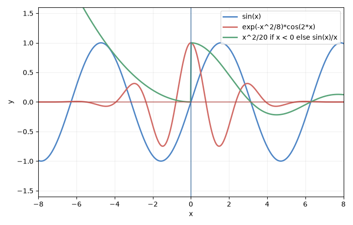
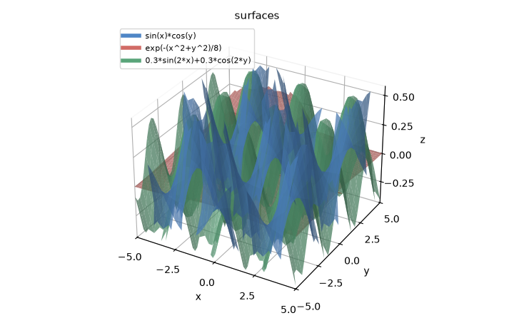
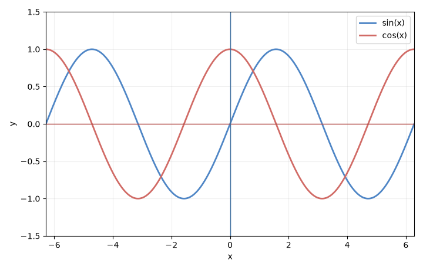
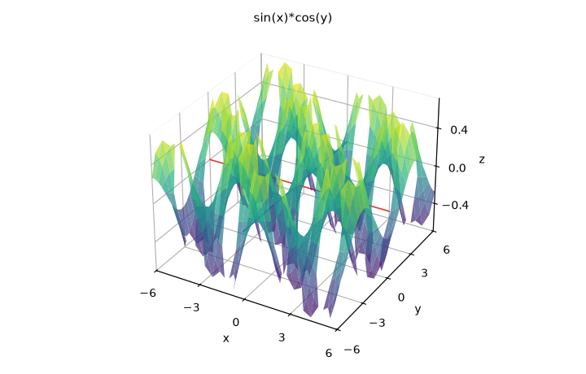
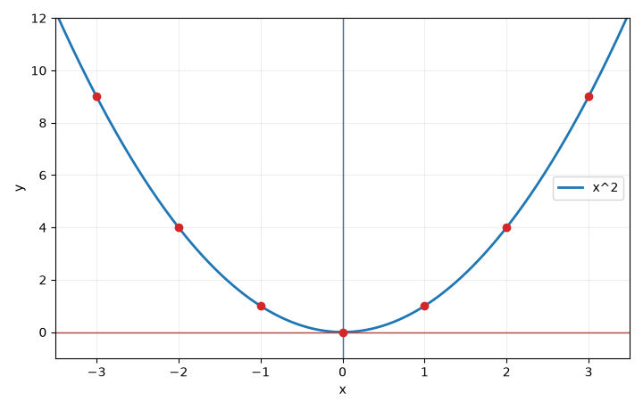
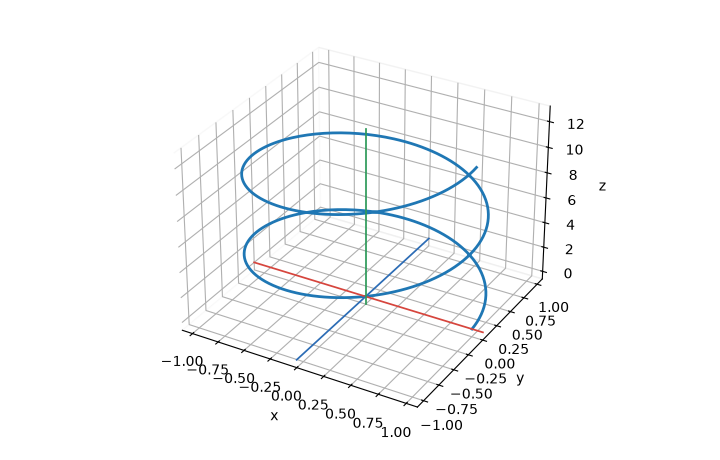
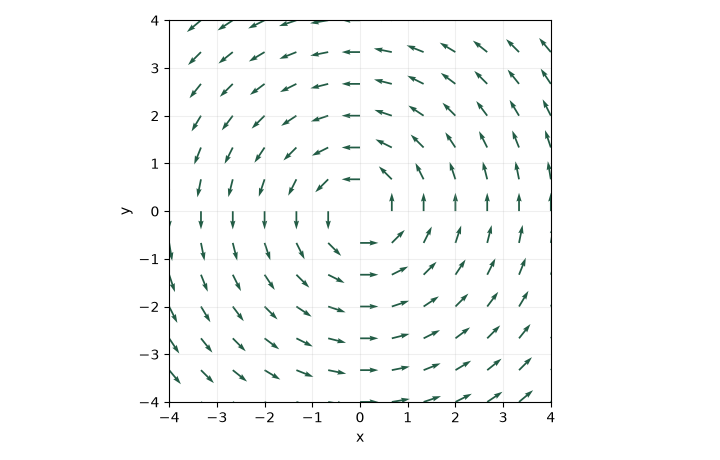
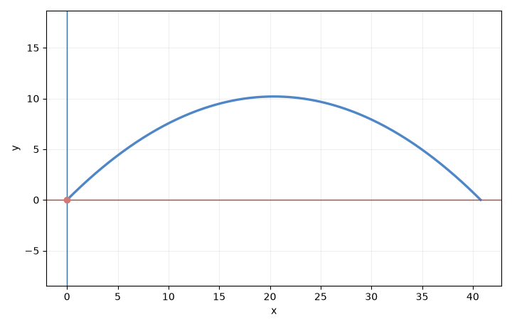

# Locus

[English](README.md) · [客户端接入](docs/CLIENTS.md) · [调用示例](docs/EXAMPLES.md)

在对话里画出公式。
安装命令是 `uv run locus`，仓库是 [Locus](https://github.com/TheGrSun/Locus)。
Python 3.10+ · FastMCP 2.x · Apache-2.0。

## 可以做什么

| 工具 | 结果 | 使用条件 |
| --- | --- | --- |
| `validate_formula` | 标准化公式，或返回可操作的修正建议 | 离线 |
| `plot_math_function` | 原生 PNG 图片及可选的保存路径 | 离线 |
| `plot_multiple_functions` | 同一坐标系比较 1–12 个函数 | 离线 |
| `explore_functions` | 这些曲线和每个公式的分析，一次返回 | 离线 |
| `plot_3d_surface` | 同一视角下 1–6 个 `z = f(x, y)` 采样曲面 | 离线 |
| `plot_points` | 二维或三维散点，可叠加一条公式 | 离线 |
| `plot_parametric` | 参数曲线 `x(t), y(t)` 或再加 `z(t)` | 离线 |
| `plot_vector_field` | 平面向量场 `(fx, fy)` 的箭头 | 离线 |
| `simulate_physics` | 抛体、简谐振动，或自定义 `x(t)`、`y(t)`，并给出轨迹 | 离线 |
| `analyze_formula` | 定义域；可进一步计算值域、导数、驻点和不可导候选点 | 离线 |

离线曲线工具使用 `y = x^2`、`2*x + 1`、`sin(x)`、`sqrt(x)`、`abs(x)` 等语法。
`plot_3d_surface` 可以画一个曲面，也可以用 `formulas` 同时画最多六个，都在同一个视角里。对话里的图不能旋转。旋转和缩放在下面的本地页面里完成。
`explore_functions` 把多条 `y=f(x)` 画在一起，并在同一次结果里返回每条的分析。

## 图长什么样

下面是离线工具直接画出的 PNG。本地页面打开时，二维和三维都已经填好同一组叠加公式。

| 多条二维曲线 | 多张三维曲面 |
| --- | --- |
|  |  |
| `sin(x)`、`exp(-x^2/8)*cos(2*x)`、`x^2/20 if x < 0 else sin(x)/x` | `sin(x)*cos(y)`、`exp(-(x^2+y^2)/8)`、`0.3*sin(2*x)+0.3*cos(2*y)` |

| 曲线 | 曲面 |
| --- | --- |
|  |  |
| `sin(x)` 与 `cos(x)` | `z = sin(x)*cos(y)`，一张 x、y、z 视图 |

| 散点 | 参数曲线 |
| --- | --- |
|  |  |
| 点落在 `y = x^2` 上 | `x = cos(t)`，`y = sin(t)`，`z = t` |

| 向量场 | 抛体 |
| --- | --- |
|  |  |
| `fx = -y`，`fy = x` | 初速 20、仰角 45 度 |

## 助手会返回什么

离线绘图返回 **MCP 原生 PNG 图片内容**，同时返回公式、警告，以及启用保存时的文件路径等文本信息。
支持图片的客户端可直接在对话中显示图形。

离线三维是采样曲面图。符号分析仍然只针对二维函数。

## 验证状态

0.2 在本地 macOS/Python 3.10 通过了 42 个 Python 测试和 3 个隔离的 JavaScript 控制器测试。另在独立安装的 wheel 中验证了命令入口、PNG 返回及 HTML 模板打包。
之后在 Linux / Python 3.11 上，`ruff check` 通过，47 个 pytest 测试通过，5 个 Node 控制器测试通过。
CI 已配置 Linux、macOS、Windows 和 Python 3.10/3.12；不表示远端所有任务已经运行通过。

图片测试核对返回的 PNG 和随图给出的说明。

## 安装并接入

先安装 [uv](https://docs.astral.sh/uv/getting-started/installation/)，然后执行：

```sh
git clone https://github.com/TheGrSun/Locus.git
cd Locus
uv sync --locked
uv run locus --help
```

按[客户端接入文档](docs/CLIENTS.md)配置 MCP。手动启动命令：

```sh
uv run locus
```

启动后等待输入是正常现象：这是 stdio MCP 服务，需要客户端通过协议调用，不是终端聊天程序。
旧命令 `uv run src/main.py` 仍可使用。

接入后可以对助手说：

> 在 -2π 到 2π 上比较 sin(x) 和 cos(x)，解释它们的交点。

> 画出 z = sin(x)*cos(y)。

对话里直接返回图片。三维结果是一张 x、y、z 坐标轴的标准视图。

想自己拖动图像时，在仓库里运行：

```sh
uv run python demo/server.py
```

然后打开 http://127.0.0.1:8766。页面只在本机监听。

页面只有两种模式，打开时各自已经画好三条公式。三维是 `sin(x)*cos(y)`、`exp(-(x^2+y^2)/8)` 和 `0.3*sin(2*x)+0.3*cos(2*y)`，带 x、y、z 坐标轴。二维是 `sin(x)`、`exp(-x^2/8)*cos(2*x)` 和 `x^2/20 if x < 0 else sin(x)/x`。可以直接粘贴普通公式或 LaTeX，例如 `\sin(x)\cos(y)`、`x^{2}`。侧栏切换语言和模式，两种模式各自保留自己的公式。三维可以拖动旋转、滚轮缩放，按钮可以回到默认方向、从正上方看 XY，或放大缩小。二维曲线上这些按钮改的是坐标范围，还可以勾选画出导数。

## Agent harness

对外的路由是服务器说明、`resources://guide`，以及 `basic_graphing_assistant`、`advanced_math_analysis`、`visualize_3d` 这三个 prompt。

## 配置

优先级：`--config 路径` → `LOCUS_CONFIG` 环境变量 → 当前目录 `config.json` → 内置默认值。
相对输出路径以配置文件所在目录为基准。

```json
{
  "output_dir": "graphs",
  "timeout_seconds": 20,
  "rendering": {
    "default_width": 900,
    "default_height": 600,
    "samples": 1600,
    "save_files": true
  }
}
```

没有配置文件时，文件保存在系统临时目录下的 `locus` 中；长期保存请指定输出目录。
文件名含 UUID，避免并发覆盖。`save_files=false` 只关闭 PNG 落盘，MCP 仍返回图片。
文件不会自动清理，可在输出目录手动删除不需要的图表。

公式长度、语法、坐标范围均有校验。绘图与符号计算在独立进程运行，超过时限会终止，同时最多运行两个计算进程。
白名单解析器不会执行输入中的 Python 代码。这是本地 stdio 服务，不是面向公开多租户环境的计算沙箱。

## 数学能力与边界

- 离线计算支持实变量 `x`，显式乘法及弧度制；常数包括 `pi`、`π`、`e`。
  函数包括 `sin/cos/tan`、`asin/acos/atan`、`sinh/cosh/tanh`、`exp`、`log/ln`、`sqrt`、`abs/Abs`。
- `basic` 计算定义域；`detailed` 增加值域和导数分析；`critical_points` 分别报告驻点和不可导候选点，不直接断言其为极值。
- 符号求解未完成时返回警告。`ConditionSet` 不代表无解；复杂计算可能超时。
- PNG 来自有限采样，间断点或高频振荡附近应缩小区间进一步检查。
- 返回路径属于服务端机器。远程客户端需要另外传输文件，不能直接打开另一台机器的本地路径。
- 暂不提供符号积分、极限工具、三维符号分析，以及网页与 MCP 的自动状态同步。
  `plot_3d_surface` 只是 `z=f(x,y)` 的有限采样。

## 开发与迁移

```sh
uv sync --locked
uv run pytest
uv run ruff check src tests
node --test tests/bounds.test.cjs tests/i18n.test.cjs
uv build
```

Node.js 22+ 仅用于交互控制器的隔离测试，运行 MCP 服务不需要 Node。
参见[贡献指南](CONTRIBUTING.md)和 [0.2 迁移说明](CHANGELOG.md)。旧配置中的 `desmos` 块已移除，需要替换为上面的格式。
HTML 模板随 Python 包一起发布，安装 wheel 后可直接使用命令入口。

许可证：[Apache-2.0](LICENSE)。
